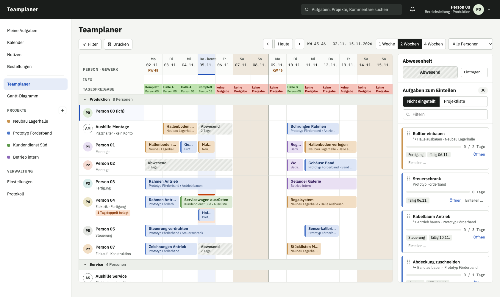
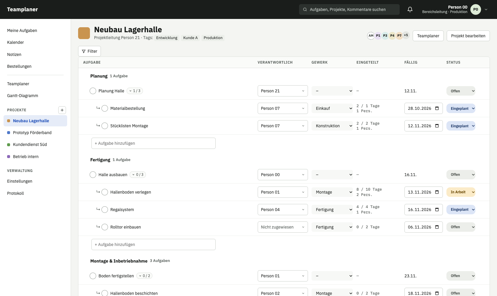
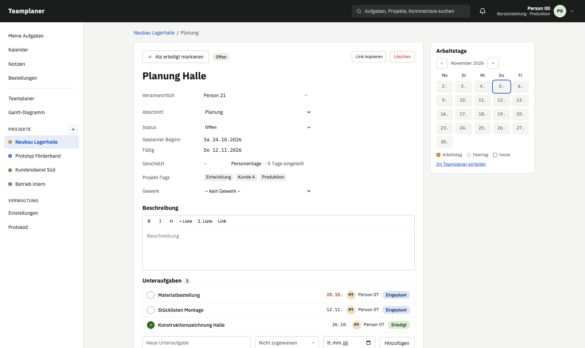
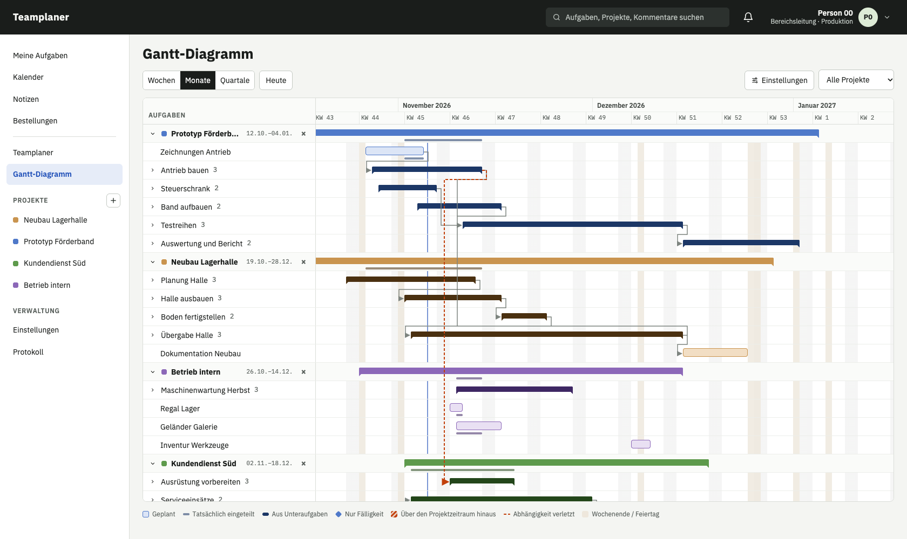
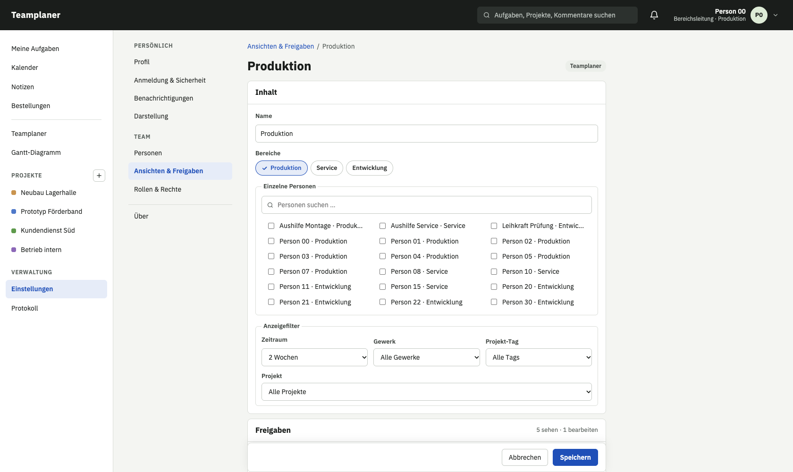
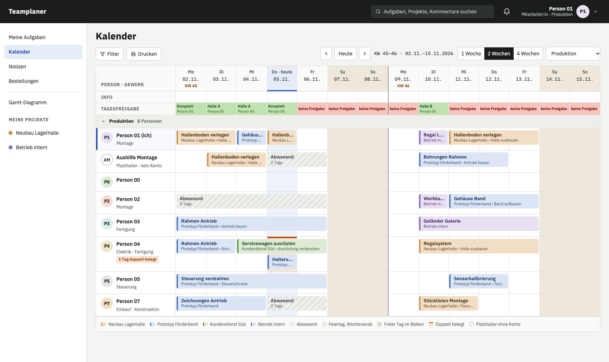
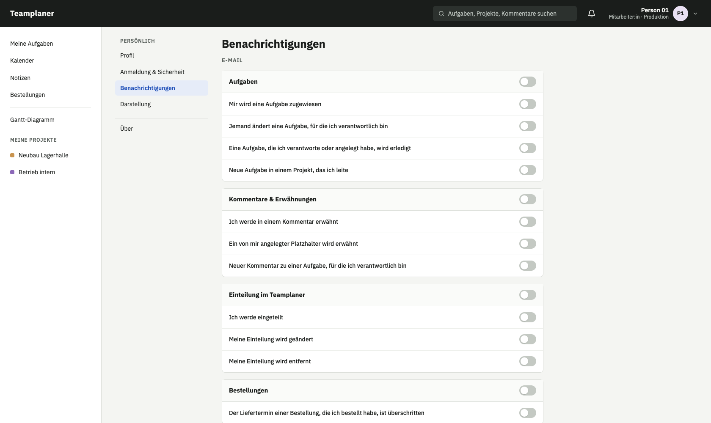
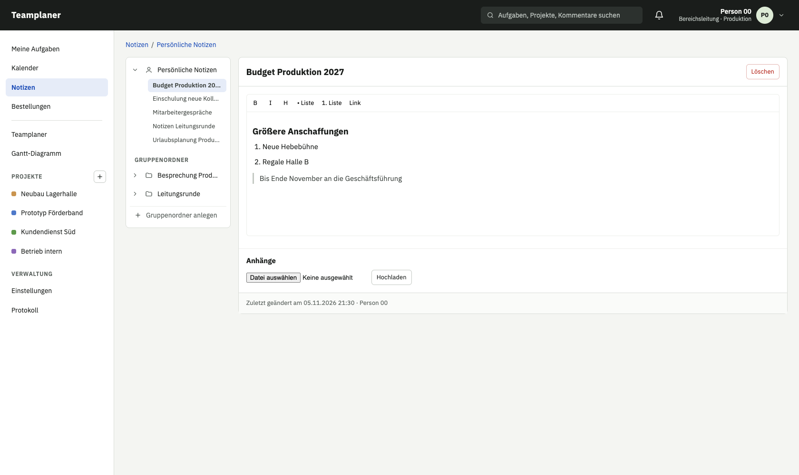
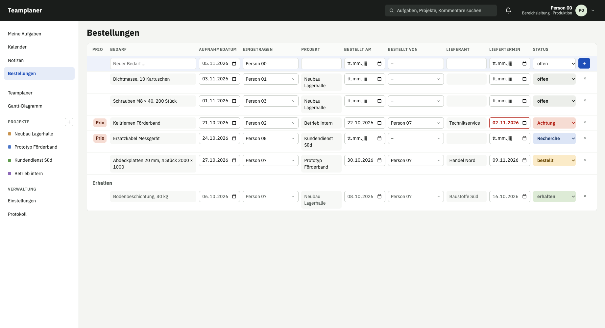
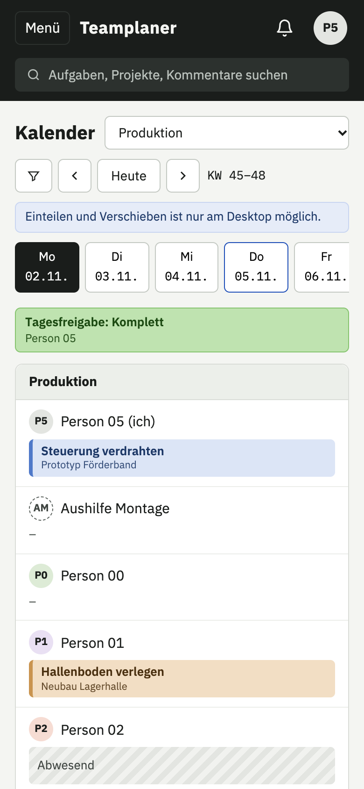

# Teamplaner

[](https://github.com/gehmacher-valentin/teamplaner/actions/workflows/tests.yml)

**Aufgaben und Wochenplanung für Teams.** Projekte und Aufgaben, dazu ein Teamplaner, in dem Aufgaben per
Drag-and-drop auf Personen und Tage gezogen werden, mit Feiertagen, Abwesenheiten, Doppelbelegung und
Live-Aktualisierung für alle. Oberfläche auf Deutsch und Englisch, zum Selbsthosten.



## Funktionen

**Teamplaner**
- Aufgabe auf Person und Tag ziehen, Balken verschieben, verlängern, kürzen, alles rückgängig machbar
- Eine Aufgabe beliebig oft einteilen: mehrere Personen parallel, auch mit Unterbrechungen
- Österreichische Feiertage automatisch, zusätzliche freie Tage, Abwesenheiten ohne Grund;
  Wochenenden sichtbar und wie Feiertage behandelt
- Info-Zeile je Tag für alle sichtbar, optional eine Zeile „Tagesfreigabe“ mit frei wählbarem Namen und
  eigenen Stufen
- Doppelbelegung wird markiert, nie verhindert
- Ansichten mit Freigaben je Person: nicht sehen, nur sehen oder bearbeiten
- Lesekalender für alle ohne Planungsrecht, Tagesansicht am Handy, Drucken
- Änderungen erscheinen sofort bei allen, die die Ansicht offen haben

**Projekte und Aufgaben**
- Projekte mit Tags, Abschnitten, Status und Priorität 1–5; Aufgaben mit Verantwortlichen, Gewerk, Schätzung,
  Fälligkeit, Unteraufgaben und Anhängen
- Direkt in der Liste bearbeiten und per Drag-and-drop sortieren, Filter, Volltextsuche
- Aufgabendetail als Seitenleiste neben der Liste
- Arbeitstage-Widget: an welchen Tagen an einer Aufgabe gearbeitet wird
- Kommentare mit @-Erwähnungen, Verlauf jeder Aufgabe, Posteingang als Glocke in der Kopfzeile

**Gantt-Diagramm**
- Projektübergreifend, mit eigenen Ansichten und Freigaben
- Abhängigkeiten „A vor B“, auch zwischen Projekten; Überschneidungen werden rot markiert
- Unter jedem Balken der tatsächlich eingeteilte Zeitraum; Termine durch Ziehen ändern

**Notizen und Bestellungen**
- Persönliche Notizen (sieht niemand sonst, auch kein Admin) und freigegebene Gruppenordner,
  mit Markdown und Anhängen
- Gemeinsame Bestellliste mit Status von „offen“ bis „erhalten“, Prio, Liefertermin mit Warnung bei
  Überschreitung und Vorschlägen für den Lieferanten; jede Änderung im Protokoll

**Außerdem**
- Feste Rollen: Admin, Bereichsleitung, Planer:in, Mitarbeiter:in, Lesend; Rechte werden immer
  auf dem Server geprüft
- Platzhalter-Personen ohne Konto, z. B. für Aushilfen
- Einladung und „Passwort vergessen“ per E-Mail; E-Mail-Benachrichtigungen fein einstellbar
- Profilfoto, Feieranimation beim Abhaken (beides optional); iPhone-Fotos (HEIC) werden beim Hochladen zu JPEG
- Änderungsprotokoll, in der Datenbank gegen Ändern und Löschen geschützt
- Admin-Übersicht der Anhänge nach Größe und Datum, um Speicherplatz freizugeben

**Sicherheit**
- Zwei-Faktor-Anmeldung mit Authenticator-App: Pflicht für Admin und Bereichsleitung, für alle
  anderen freiwillig; Ersatzcodes für den Notfall
- Sperre nach wiederholten Fehlversuchen, je Konto und je IP-Adresse
- Angemeldet bleiben bis 30 Tage; Admins nach 60 Minuten ohne Aktivität abgemeldet, die Restzeit steht
  in der Kopfzeile und lässt sich per Klick zurücksetzen
- Konten ändern nur für Personen mit niedrigerer Rolle; Passwort-Links nur per Mail an die Person
- Löschfristen: Protokolle und Benachrichtigungen nach einem Jahr, persönliche Daten
  deaktivierter Konten nach drei Monaten
- Strenge Content-Security-Policy, geprüfte Datei-Uploads

## Ansichten

| | |
| --- | --- |
|  |  |
| **Aufgabenliste**: direkt bearbeiten, sortieren, filtern | **Aufgabendetail**: Arbeitstage, Abhängigkeiten, Unteraufgaben |
|  |  |
| **Gantt-Diagramm**: Abhängigkeiten auch zwischen Projekten | **Teamplaner-Ansichten**: wer was sehen und bearbeiten darf |
|  |  |
| **Kalender**: für alle ohne Planungsrecht | **Einstellungen**: Profil, Sicherheit, Benachrichtigungen, Darstellung |
|  |  |
| **Notizen**: persönlich oder in freigegebenen Gruppenordnern | **Bestellungen**: eine Liste für alle, sortiert nach Status |



**Am Handy** zeigt der Teamplaner eine Tagesansicht: Tag wählen, sehen, wer woran arbeitet,
Karte antippen öffnet die Aufgabe. Eingeteilt wird am Desktop.

Die Bilder zeigen Demodaten mit Platzhalternamen.

<br clear="right">

## Installation

| Weg | Für | Anleitung |
| --- | --- | --- |
| Linux-Server ohne Docker | Betrieb mit systemd, nginx oder Apache und PostgreSQL | [docs/installation-linux.md](docs/installation-linux.md) |
| Docker | VM, gemieteter Server, Kleinrechner mit arm64 | [docs/betrieb.md](docs/betrieb.md) |

Beide Wege bringen wöchentliche Sicherung und Updates auf Befehl mit: Vorher wird gesichert, und startet
die neue Version nicht, geht es automatisch zurück.

## Schnellstart

Entwicklungsumgebung auf dem eigenen Rechner. Nötig sind Docker und Node.js 20 oder neuer.

```bash
cd frontend && npm ci && npm run build && cd ..
docker compose up -d
docker compose exec app python manage.py migrate
docker compose exec app python manage.py demodaten
```

Dann http://localhost:8000 öffnen. Demo-Konten (nur lokal), Passwort jeweils `Teamplaner-Demo-2026`:

| Konto | Rolle |
| --- | --- |
| `bereichsleitung@example.test` | Bereichsleitung: sieht und plant alles |
| `planer@example.test` | Planer:in: plant die Produktion |
| `mitarbeiter@example.test` | Mitarbeiter:in: Lesekalender, eigene Aufgaben |
| `lesend@example.test` | Lesend |
| `admin@example.test` | Admin: zusätzlich Personen, Rollen, Einstellungen |

Admin und Bereichsleitung richten bei der ersten Anmeldung die Zwei-Faktor-Anmeldung ein
(Authenticator-App). Alle E-Mails landen in Mailpit unter http://localhost:8025.

Tests und alles Weitere: [docs/entwicklung.md](docs/entwicklung.md).

## Technik

Python mit Django 5.2 LTS, PostgreSQL, Django-Templates mit HTMX für die Formularseiten, React mit
TypeScript für Teamplaner und Gantt-Diagramm, Live-Aktualisierung per Server-Sent Events und
PostgreSQL `LISTEN/NOTIFY`. Tests mit pytest und vitest.

## Lizenz

Copyright (C) 2026 Valentin Gehmacher. GNU Affero General Public License, Version 3 oder später
([LICENSE](LICENSE)). Enthaltene Fremdwerke: [THIRD-PARTY.md](THIRD-PARTY.md). Sicherheitslücken bitte wie
in [SECURITY.md](SECURITY.md) beschrieben melden.
